# Home SOC Lab | Detection Engineering with Splunk, Sysmon & Atomic Red Team

> **Portfolio repository draft — authorship and screenshot publication review required before making public.** See [Attribution review](docs/ATTRIBUTION_REVIEW_REQUIRED.md). This lab is a **single-host learning environment**, not a production SOC.

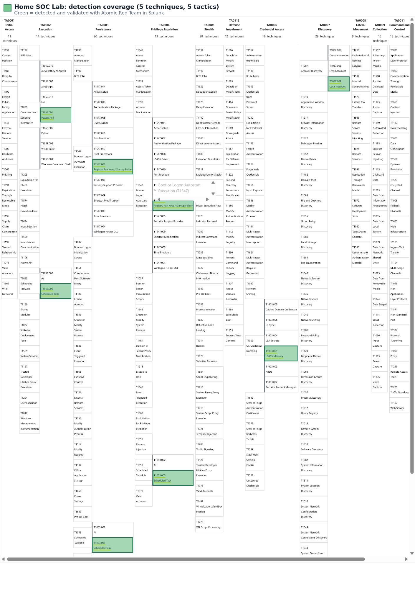

A documented Windows 11 security-operations lab that collects endpoint telemetry with **Sysmon**, analyzes events in **Splunk Enterprise**, executes controlled **Atomic Red Team** simulations, develops ATT&CK-mapped detection logic, and investigates false positives.

## Project at a glance

| Area | Implementation |
|---|---|
| Environment | VirtualBox, Windows 11 VM |
| Telemetry | Microsoft Sysmon, Windows Event Log |
| SIEM | Splunk Enterprise on the same VM |
| Collection | Splunk `inputs.conf` reading `Microsoft-Windows-Sysmon/Operational` into `sysmon` |
| Simulation | Atomic Red Team, isolated lab only |
| Detection | Splunk SPL, Sigma-style rule documentation |
| Framework | MITRE ATT&CK Enterprise |
| Validated scenarios | 5 distinct ATT&CK subtechniques demonstrated in lab evidence |
| Current limitation | Longer normal-use false-positive testing remains incomplete |

## Architecture

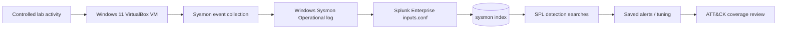

Splunk and Sysmon run **on the same Windows 11 VM**; no external forwarder or production endpoints were used. For the full walkthrough, see [Architecture and methodology](docs/ARCHITECTURE.md).

## Detection coverage

| MITRE ATT&CK | Behavior tested | Primary signal | Outcome |
|---|---|---|---|
| [T1053.005](https://attack.mitre.org/techniques/T1053/005/) | Scheduled task creation | Sysmon Event ID 1, `schtasks.exe /create` | Validated; tuned for Office updater noise |
| [T1547.001](https://attack.mitre.org/techniques/T1547/001/) | Registry Run key persistence | Sysmon Event ID 13, Run key value write | Validated |
| [T1087.001](https://attack.mitre.org/techniques/T1087/001/) | Local account discovery | Sysmon Event ID 1, `net.exe` / `net1.exe` | Validated; excludes account modification |
| [T1059.001](https://attack.mitre.org/techniques/T1059/001/) | Encoded PowerShell execution | Sysmon Event ID 1 and command-line flags | Validated; expanded abbreviated switches |
| [T1003.001](https://attack.mitre.org/techniques/T1003/001/) | LSASS access via `comsvcs` MiniDump | Sysmon Event ID 1, `rundll32.exe` and `comsvcs` | Validated; tuned to avoid routine LSASS access |

**Interpretation:** A successful lab test means the *specific simulated behavior* was observed and matched. It does not imply complete detection coverage for each technique or broad production readiness. [Detection rationale](docs/DETECTIONS.md) · [ATT&CK Navigator layer](detections/mitre-attack-coverage.json)

## What the evidence shows

<details><summary><b>1 — Virtualized lab and telemetry</b></summary>

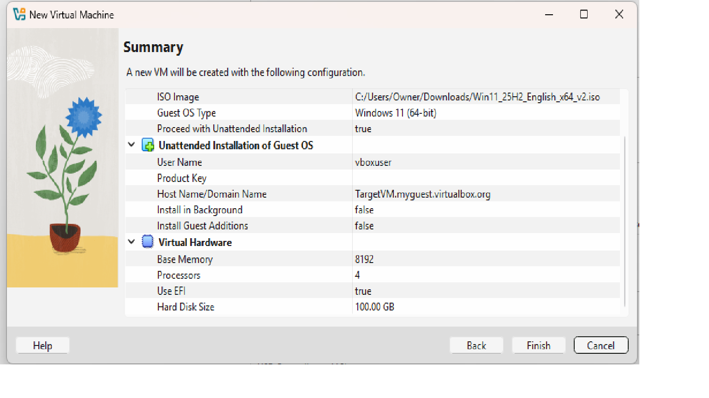

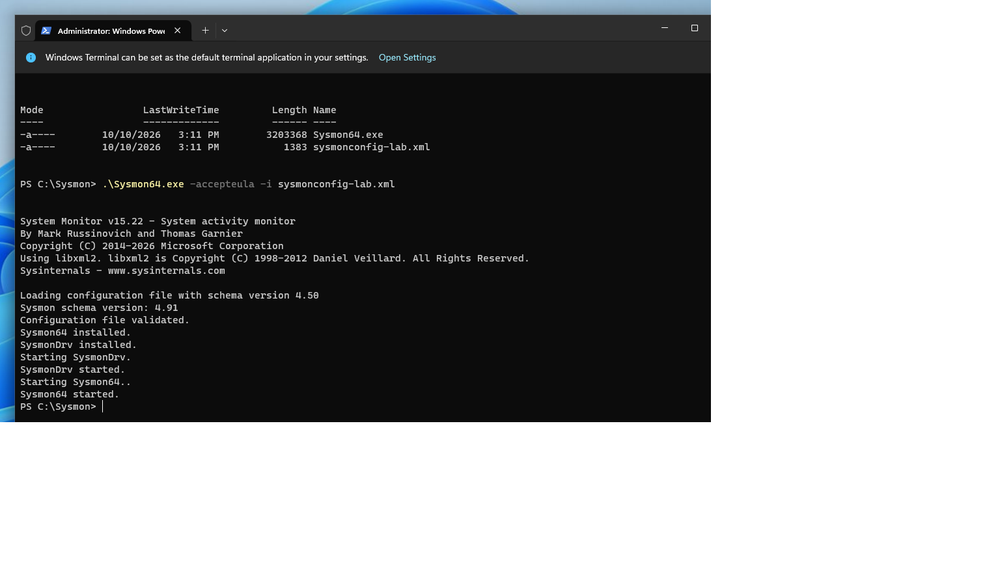
</details>

<details><summary><b>2 — Log ingestion and parsing troubleshooting</b></summary>

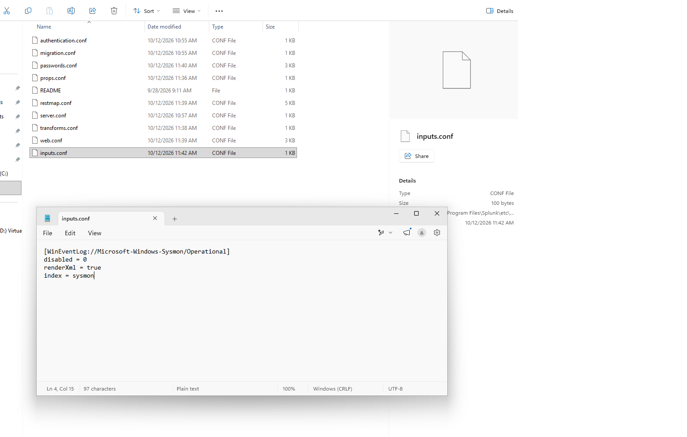

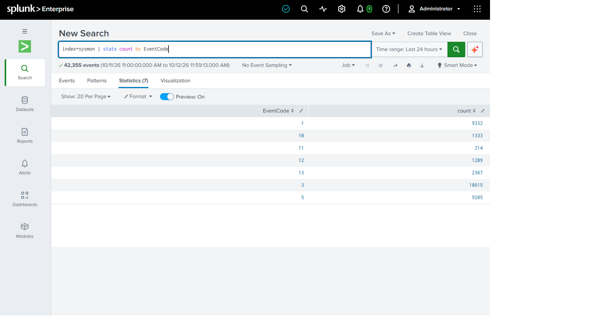

**Lesson:** Ingesting data is not the same as parsing the fields needed for detection. Inline `rex` expressions confirmed XML fields while configuration was being investigated.
</details>

<details><summary><b>3 — Simulation and detection</b></summary>

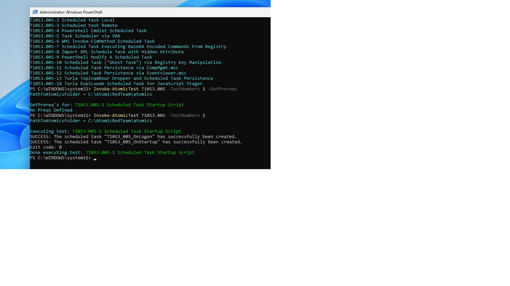

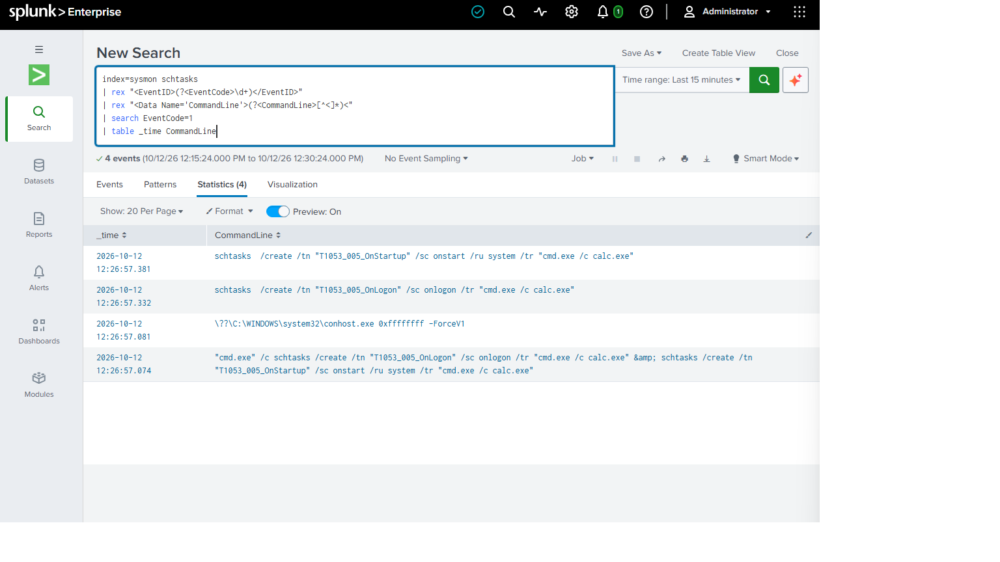

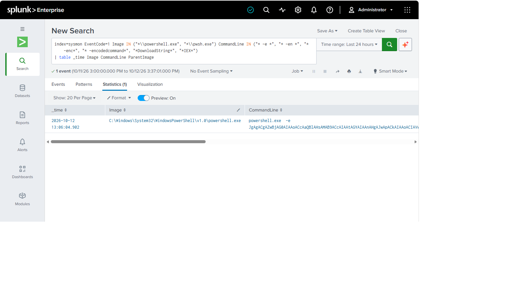

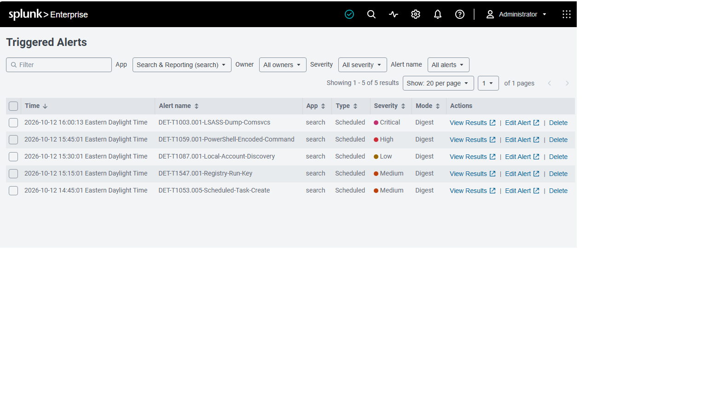
</details>

<details><summary><b>4 — False-positive tuning and coverage</b></summary>

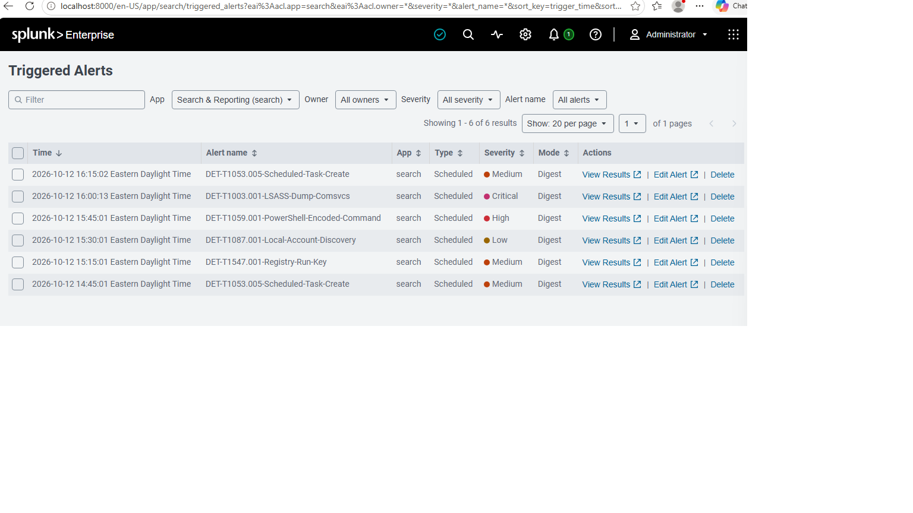

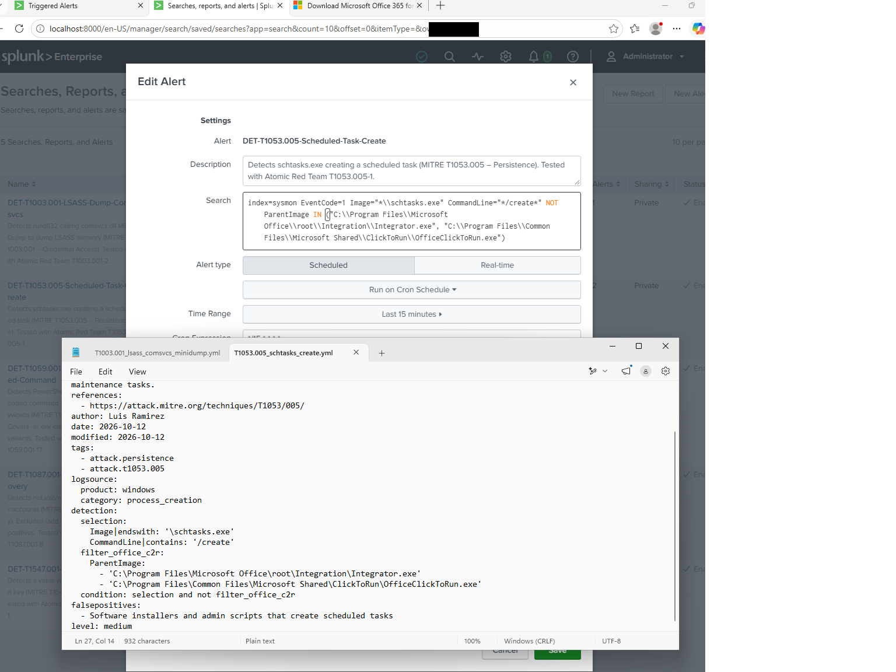


</details>

More images and explanatory captions: [Screenshot evidence](docs/EVIDENCE.md).

## Problems solved

1. **Unavailable Sysmon add-on:** Used lab-specific XML extraction workarounds and inline SPL parsing rather than abandoning telemetry analysis.
2. **Events without usable fields:** Investigated sourcetype/stanza behavior; verified `EventCode` extraction with inline `rex`.
3. **Encoded PowerShell evasion of a narrow rule:** Expanded abbreviated `-EncodedCommand` switches after a documented missed test.
4. **Benign account and task activity:** Removed noisy installation/update patterns without suppressing the targeted simulation.
5. **LSASS noise:** Focused on specific `rundll32` + `comsvcs` execution rather than alerting on every LSASS access event.

Read the [tuning case studies](docs/TUNING_CASE_STUDIES.md) for evidence, reasons, and trade-offs.

## Repository structure

```text
Home-SOC-Lab/
├── README.md
├── assets/screenshots/             # Selected, source-evidenced screenshots
├── detections/
│   ├── splunk/                 # SPL examples for the validated behaviors
│   ├── sigma/                  # Explanatory detection templates
│   └── mitre-attack-coverage.json
└── docs/
    ├── ARCHITECTURE.md
    ├── DETECTIONS.md
    ├── EVIDENCE.md
    ├── TUNING_CASE_STUDIES.md
    ├── LIMITATIONS.md
    └── ATTRIBUTION_REVIEW_REQUIRED.md
```

## Key takeaways

- Event generation, ingestion, field extraction, rule logic, and alerting must each be independently verified.
- Detection quality is as much about avoiding noisy benign activity as catching a test.
- ATT&CK coverage is a mapping of specific validated behaviors, not a blanket claim of protection.

## Future work

- Complete extended baseline testing during normal activities and record false-positive rates.
- Review detections against varied benign and malicious command-line examples.
- Add reproducible local configurations after removing machine-specific paths and sensitive values.
- Validate rules in an additional environment and automate regression tests.

---

**Safety:** Controlled tests were performed in an isolated VM. Do not use these techniques against systems without explicit authorization. Never commit private logs, credentials, or live endpoint identifiers.
